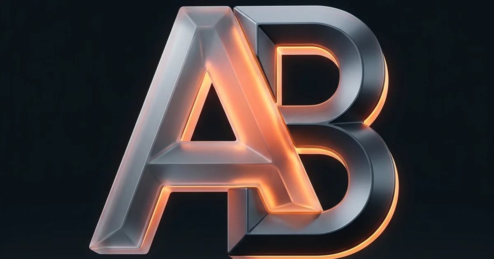

# Assia Benkedia - Flagship Portfolio

[](https://nextjs.org/) [](https://www.typescriptlang.org/) [](https://tailwindcss.com/) [](https://vercel.com/)

> **Live Demo:** [https://portfolio-web-tuba89.vercel.app](https://portfolio-web-tuba89.vercel.app)

Trilingual (English · Français · العربية RTL) production portfolio for **Assia Benkedia** — AI & Full-Stack Developer, Mobile Engineer (React Native & Expo), Fintech Core Contributor at DizzitUp (54 African Nations), and Kaggle Silver Medalist (33rd / 2,674).



---

## Highlights & Features

- **Trilingual Localization (i18n):** Complete native translation across English, French, and Arabic with true bidirectional RTL rendering and custom Arabic typography (IBM Plex Sans Arabic).
- **Technology & Issuer Logos:** Standardized Simple Icons (`react-icons/si`) and official SVGs with monochrome default and brand-color hover states across project stack chips, the skills matrix, a core tech strip, and verified issuer cards (Kaggle, Google, Cisco, Deloitte, Codecademy, University of the People).
- **Light & Dark Mode:** Accessible color tokens with automatic `currentColor` dark-mode flipping for monochrome logos (Next.js, Prisma, Expo, Vercel).
- **100% Responsive Design:** Verified with Playwright from ultra-compact viewports (320px, 375px iPhone SE) to 1440px+ ultra-wide desktop with zero horizontal overflow (`scrollWidth <= innerWidth`).
- **Interactive Lightbox:** Full-screen modal viewing for accredited degree diplomas and certificates.

---

## Tech Stack

- **Framework:** Next.js 16 (App Router with Turbopack) & React 19
- **Languages:** TypeScript, JavaScript, Python, Solidity
- **Styling:** Tailwind CSS v4, Lucide Icons, Simple Icons (`react-icons/si`)
- **Backend & Data:** Supabase PostgreSQL, Prisma ORM, Node.js, Express
- **Mobile:** React Native, Expo, Android Emulator

---

## Getting Started

```bash
# Clone the repository
git clone https://github.com/tuba89/portfolio.git
cd portfolio/portfolio-web

# Install dependencies
npm install

# Start local development server (port 3050)
npm run dev
```

Open [http://localhost:3050](http://localhost:3050) in your browser.

---

## Production Build

```bash
npm run build
npm run start
```
